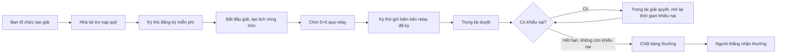
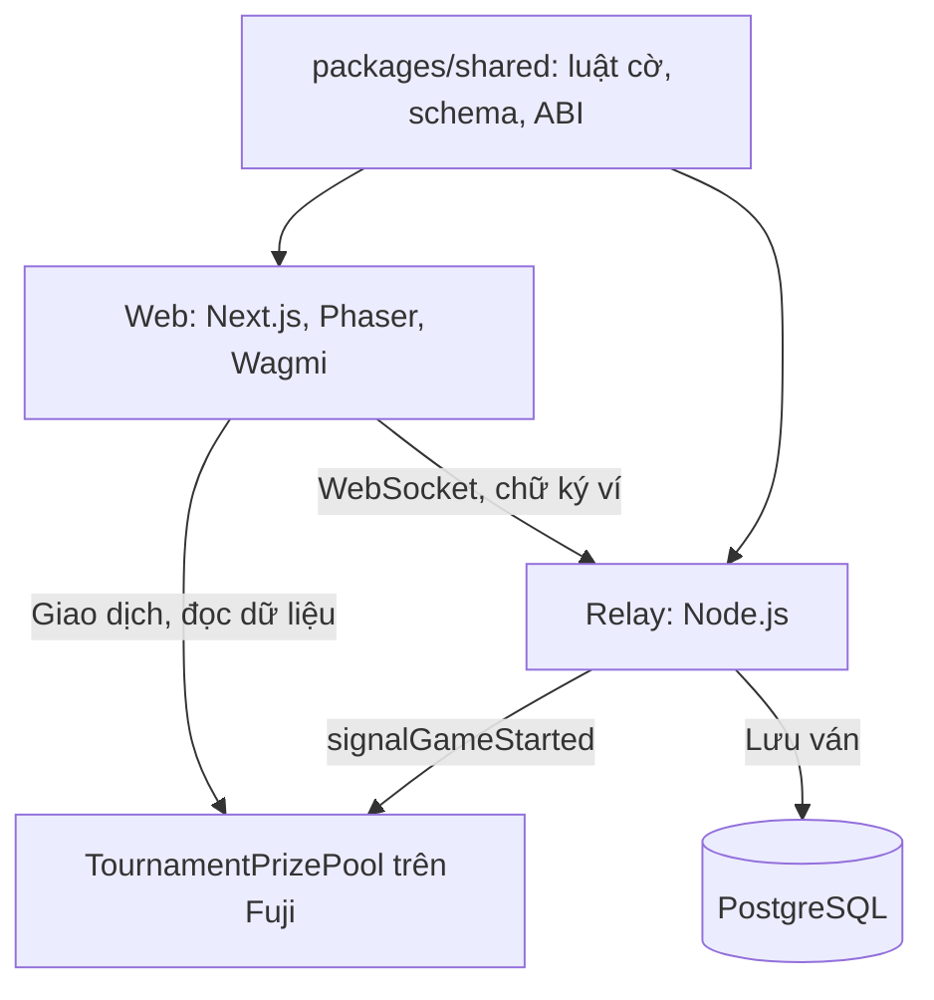

# AvaClash Cup

Giải cờ vua online miễn phí tham dự, quỹ thưởng do nhà tài trợ nạp trước và được giải ngân bằng hợp đồng thông minh trên Avalanche Fuji.

|                           |                                                                                                                                               |
| ------------------------- | --------------------------------------------------------------------------------------------------------------------------------------------- |
| **Dùng thử**              | [avaclash-chess.vercel.app](https://avaclash-chess.vercel.app)                                                                                |
| **Mạng**                  | Avalanche Fuji C-Chain (chain ID 43113), chỉ dùng token thử nghiệm                                                                            |
| **Hợp đồng giải**         | [`0x268F6034175750791AAaA20FD04F658BDDAcB9F9`](https://explorer-test.avax.network/c-chain/address/0x268F6034175750791AAaA20FD04F658BDDAcB9F9) |
| **Giải mẫu đã chơi thật** | [Giải #1 ASTAR](https://avaclash-chess.vercel.app/tournaments?id=1)                                                                           |
| **Video demo**            | Cập nhật trước khi nộp                                                                                                                        |
| **Slide**                 | Cập nhật trước khi nộp                                                                                                                        |

Dự án tham gia [Team1 Vietnam UniHack: 30 days to build on Avalanche](https://team1vn.xyz).

## Vấn đề và giải pháp

Giải cờ online nhỏ thường do một người giữ tiền thưởng và tự đối soát kết quả. Nhà tài trợ khó kiểm tra tiền đã đi đâu, còn kỳ thủ chỉ biết tin vào lời hứa của ban tổ chức.

AvaClash Cup tách các quyền đó ra và ghi lại trên chuỗi:

- **Nhà tài trợ** nạp quỹ vào hợp đồng trước khi giải mở đăng ký.
- **Kỳ thủ** tham dự miễn phí, không đặt cược. Người thua không mất tiền cho người thắng.
- **Relay** kiểm luật cờ và ký biên bản ván, nên kỳ thủ không thể tự khai kết quả.
- **Trọng tài** duyệt kết quả và giải quyết khiếu nại, là ví riêng khác ban tổ chức.
- **Hợp đồng** tính bảng thưởng theo điểm đã duyệt. Người được thưởng tự nhận trong 30 ngày, phần chưa dùng được hoàn lại nhà tài trợ.

## Luồng một giải



Điểm: thắng 1, hòa ½, thua 0. Giải 2 kỳ thủ chia 70/30; giải 3 đến 8 kỳ thủ chia 60/30/10. Đồng điểm thì chia đều phần thưởng của các hạng liên quan.

## Dùng Avalanche ở đâu

Toàn bộ dòng tiền và trạng thái giải nằm trong hợp đồng [`TournamentPrizePool`](contracts/src/TournamentPrizePool.sol) trên Fuji C-Chain:

| Thành phần         | Cách hoạt động                                                                                                           |
| ------------------ | ------------------------------------------------------------------------------------------------------------------------ |
| Quỹ thưởng         | `fund` nhận AVAX test vào quỹ riêng của từng giải, ví kỳ thủ và trọng tài không được nạp                                 |
| Tách quyền         | Ban tổ chức, trọng tài, relay và kỳ thủ phải là các ví khác nhau, hợp đồng kiểm tra khi tạo giải và đăng ký              |
| Biên bản ván       | Chữ ký EIP-712 của relay gồm người thắng, lý do, số nước và hash nước đi; `reportResult` khôi phục chữ ký trước khi nhận |
| Duyệt và khiếu nại | `review`, `appeal`, `resolveAppeal` lưu mã kiểm chứng và phát sự kiện công khai                                          |
| Giải ngân          | `finalize` tính theo điểm đã duyệt, chặn khi còn khiếu nại mở; `claim` chống nhận trùng                                  |
| Đăng nhập          | Ký thông điệp bằng ví, máy chủ xác minh chữ ký trước khi cấp phiên                                                       |

## Kiến trúc



| Thư mục                              | Nội dung                                                   |
| ------------------------------------ | ---------------------------------------------------------- |
| [`contracts`](contracts)             | Solidity 0.8.24, OpenZeppelin, kiểm thử bằng Foundry       |
| [`packages/relay`](packages/relay)   | Xác thực ví, kiểm luật và thứ tự nước, đồng hồ, ký kết quả |
| [`packages/shared`](packages/shared) | Luật cờ, replay, hash nước đi, schema Zod, ABI             |
| [`web`](web)                         | Giao diện tiếng Việt và tiếng Anh                          |

## Dùng thử

**Không cần ví:** [giải thế cờ](https://avaclash-chess.vercel.app/practice) và [chơi cùng thiết bị](https://avaclash-chess.vercel.app/hotseat).

**Xem kết quả có sẵn:** mở [giải #1 ASTAR](https://avaclash-chess.vercel.app/tournaments?id=1), vào **Lịch ván** để xem biên bản, hash đối chiếu và tải PGN.

**Chạy trọn một giải** cần 4 ví MetaMask hoặc Core trên Fuji, lấy AVAX test tại [faucet](https://build.avax.network/console/primary-network/faucet):

1. Ví ban tổ chức [tạo giải](https://avaclash-chess.vercel.app/tournaments/new) 2 kỳ thủ, nhập ví trọng tài khác ví của mình, rồi nạp quỹ.
2. Hai ví kỳ thủ mở link giải và bấm **Đăng ký miễn phí**.
3. Ví ban tổ chức bấm **Bắt đầu giải**.
4. Hai kỳ thủ bấm **Vào trận**, ký xác thực và chơi. Hết ván, một người gửi biên bản lên chuỗi.
5. Ví trọng tài mở ván, chọn kết quả và bấm **Duyệt ván**.
6. Hết thời gian khiếu nại (ít nhất 1 giờ), bấm **Chốt bảng thưởng** rồi **Nhận thưởng**.

## Chạy cục bộ

Cần Node.js 20.12 trở lên, pnpm 9.15 và [Foundry](https://getfoundry.sh).

```bash
git clone --recurse-submodules https://github.com/duongpdd/AVACLASH-CHESS.git
cd AVACLASH-CHESS
pnpm install --frozen-lockfile
node scripts/dev-tournament.mjs --seed
```

Mở `http://127.0.0.1:13000/tournaments`. Lệnh này dựng Anvil, deploy hợp đồng, tạo giải 8 kỳ thủ đã có lịch và chạy relay. Xem chi tiết tài khoản thử nghiệm và cách triển khai Fuji tại [hướng dẫn demo](docs/TOURNAMENT_DEMO.md).

## Kiểm thử

```bash
forge test --root contracts --no-match-path "test/audit/**"
pnpm test
pnpm test:tournament
pnpm typecheck
pnpm lint
```

Số bài kiểm thử gần nhất, ngày 07/11/2026:

| Phần                                   | Kết quả                                        |
| -------------------------------------- | ---------------------------------------------- |
| Hợp đồng                               | 189 đạt                                        |
| Web                                    | 213 đạt                                        |
| Shared                                 | 133 đạt                                        |
| Relay                                  | 89 đạt, 3 bài cần PostgreSQL riêng được bỏ qua |
| Trọn giải trên Anvil và WebSocket thật | Đạt                                            |

CI chạy trên mỗi lần push: [GitHub Actions](https://github.com/duongpdd/AVACLASH-CHESS/actions).

## Phần có sẵn và phần xây trong cuộc thi

Thể lệ cho phép dùng dự án có sẵn, nên nhóm khai rõ:

- **Có từ trước (từ 10/2026):** bản cờ 1v1 có cược gồm `ChessEscrow`, `AvaClashMeta`, relay, bàn cờ và ví. Xem [tài liệu bản cũ](docs/LEGACY_1V1.md).
- **Xây trong kỳ thi (từ 02/11/2026):** chuyển sang mô hình miễn phí tham dự và có tài trợ, gồm hợp đồng `TournamentPrizePool`, luồng trọng tài và khiếu nại, giao diện giải đấu, bảng Elo, giải thế cờ. Lý do chuyển hướng nằm trong [nghiên cứu sản phẩm](docs/TOURNAMENT_PIVOT_RESEARCH_2026-11-03.md).

## Giới hạn hiện tại

- Chỉ chạy trên testnet, hợp đồng chưa qua audit độc lập.
- Hash nước đi chứng minh biên bản không bị sửa, không chứng minh kỳ thủ không dùng engine. Việc này thuộc về trọng tài.
- Relay và trọng tài là các bên được tin cậy. Hợp đồng không tự kiểm luật cờ.
- Relay chạy trên gói miễn phí của Render nên lần kết nối đầu có thể chậm.
- Bản thương mại với tiền thật cần thẩm định pháp lý riêng, xem [nghiên cứu sản phẩm](docs/TOURNAMENT_PIVOT_RESEARCH_2026-11-03.md).

## Tài liệu

[Danh mục tài liệu](docs/README.md) · [Kiến trúc](docs/ARCHITECTURE.md) · [Giao thức relay](docs/PROTOCOL.md) · [Hướng dẫn demo](docs/TOURNAMENT_DEMO.md) · [Triển khai Render](docs/RENDER_DEPLOY.md) · [Vận hành](docs/OPERATIONS.md)
