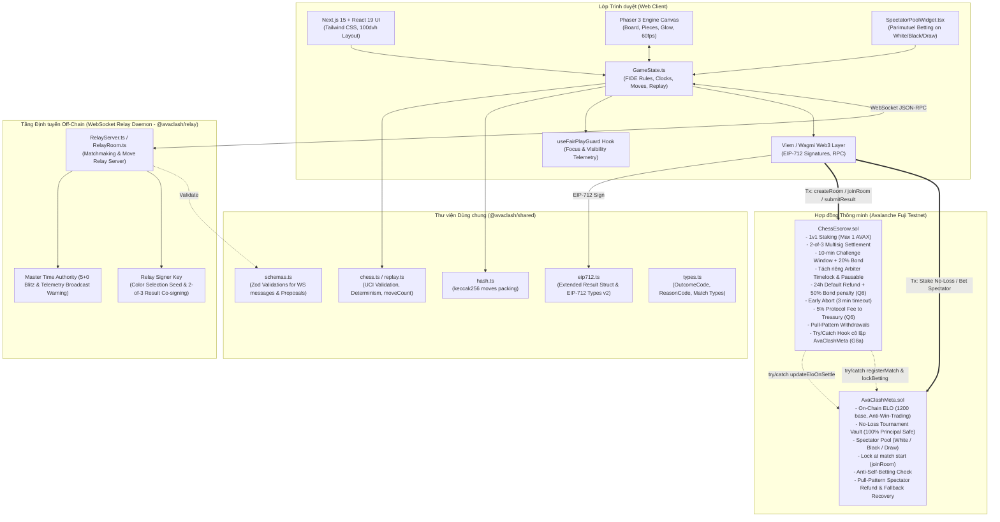
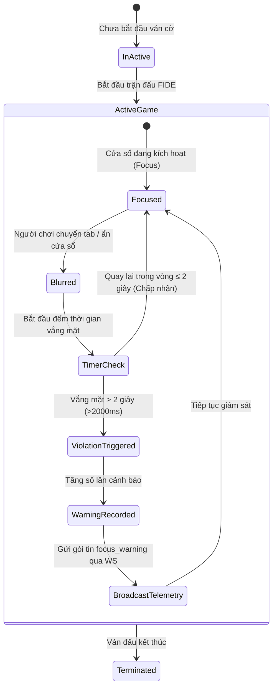

# Tài liệu Thiết kế Kiến trúc Hệ thống — AvaClash Chess

> **Phiên bản:** 1.2.0 (Phase 5 Completed) | **Ngày cập nhật:** 25/10/2026  
> **Mạng mục tiêu:** Avalanche Fuji Testnet / Avalanche C-Chain

---

## 1. Triết lý Thiết kế (Design Philosophy)

AvaClash Chess được xây dựng dựa trên nguyên lý kiến trúc cốt lõi:

> **"Pure FIDE Core + Web3 Meta Layer"**  
> _Giữ nguyên 100% luật cờ vua quốc tế FIDE chuẩn mực (không bổ sung thuộc tính giả lập, không sửa đổi luật bàn cờ), toàn bộ cơ chế kinh tế và danh tiếng Web3 được tách biệt hoàn toàn thành một tầng siêu dữ liệu (Meta Layer)._

1. **Deterministic Execution (Tính tất định):** Mọi nước đi được biểu diễn dưới dạng UCI (`e2e4`, `g1f3`). Bất kỳ client hoặc smart contract nào cũng có thể diễn lại (replay) toàn bộ ván đấu từ chuỗi rỗng để cho ra kết cục giống hệt nhau (`replayMoves`).
2. **Minimal On-Chain Footprint (Tối ưu Gas on-chain):** Trận đấu cờ vua diễn ra hoàn toàn off-chain với độ trễ thấp (sub-second latency). On-chain chỉ ghi nhận: nạp cược lúc bắt đầu, băm chuỗi nước đi (`movesHash`), biên bản EIP-712 có chữ ký mật mã, và thanh toán giải ngân cuối cùng.
3. **2-of-3 Flexible Consensus & Optimistic Fallback (Đồng thuận 2-trong-3 & Dự phòng Lạc quan):** 
   - Ưu tiên thanh toán tức thì thông qua cơ chế 2-trong-3 chữ ký (Player A + Player B, HOẶC Người thắng + Relay).
   - Nếu bên thua bất hợp tác và Relay ngoại tuyến, bên thắng có quyền nộp đơn 1 chữ ký (`submitSingleSigned`) kèm cửa sổ thử thách 10 phút.
   - Khiếu nại (`challenge`) yêu cầu đặt cọc bảo đảm (Bond 20%, min 0.01 AVAX) và có cơ chế phán quyết mặc định sau 24h phạt 50% bond bên khiếu nại chuyển cho bên nộp đơn nếu trọng tài không phản hồi (ADR Q8).

---

## 2. Sơ đồ Kiến trúc Tổng thể (System Overview)



---

## 3. Cấu trúc Monorepo & Phân chia Trách nhiệm

Dự án áp dụng **pnpm workspaces** nhằm tối ưu hóa việc tái sử dụng code giữa các gói (211/211 tests passing):

```
avaclash-chess/
├── contracts/               # Foundry Smart Contracts (93 tests pass)
│   ├── src/
│   │   ├── ChessEscrow.sol  # Hợp đồng ký quỹ, chữ ký 2-of-3, tách riêng Arbiter, Pausable, try/catch hook Meta
│   │   └── AvaClashMeta.sol # Hợp đồng ELO, No-Loss Vault & Spectator Pool (White/Black/Draw)
│   ├── script/
│   │   └── Deploy.s.sol     # Script deploy và liên kết setEscrowContract + setMetaContract trên Fuji
│   └── test/
│       ├── ChessEscrow.t.sol# 71 tests: Unit, Fuzz, 2-of-3 Sigs, Challenge Bond 50/50, Arbiter, Pausable, Fees
│       ├── AvaClashMeta.t.sol# 14 tests: ELO decay, Parimutuel payout, Draw, Cancel refund, Anti-self-bet
│       ├── ChessEscrowMetaIntegration.t.sol # 3 tests: Full match flow, Draw, Abort prediction refund
│       └── ChessEscrowMetaTryCatch.t.sol    # 5 tests: Try/catch cô lập, settle/refund an toàn, spectator recovery
├── packages/
│   ├── shared/              # Thư viện TypeScript dùng chung (94 tests pass)
│   │   └── src/
│   │       ├── chess.ts     # Wrapper cho engine chess.js
│   │       ├── replay.ts    # Diễn lại ván cờ deterministic, trả outcome, reason, moveCount
│   │       ├── hash.ts      # Băm danh sách nước đi theo keccak256
│   │       ├── eip712.ts    # EIP-712 Typed Data version 2 khớp chính xác struct Result của Solidity
│   │       ├── schemas.ts   # Zod schema cho toàn bộ gói tin WebSocket và đề xuất kết quả
│   │       ├── types.ts     # Kiểu dữ liệu gốc, enum số OutcomeCode (0-2) và ReasonCode (0-7)
│   │       └── index.ts     # Entry point xuất khẩu toàn bộ thư viện
│   │   └── tests/           # 5 test suites (types, eip712, schemas, replay, hash)
│   └── relay/               # WebSocket Matchmaking & Move Relay Daemon (7 tests pass)
│       └── src/
│           ├── RelayRoom.ts # Quản lý ván cờ, đồng hồ FIDE 5+0, telemetry warning broadcast (không trừ giờ)
│           ├── RelayServer.ts # Xử lý kết nối WS, đồng thuận 2-of-3 và ký EIP-712 (yêu cầu biến môi trường)
│           └── index.ts     # Entry point daemon chạy cổng 8080
│       └── tests/           # 1 test suite (relay.test.ts: matchmaking, turns, resign, draw, telemetry, env key)
├── web/                     # Ứng dụng Frontend Next.js 15 (17 tests pass)
│   └── src/
│       ├── app/             # App Router (Trang chủ Lobby và Đấu trường cờ /game)
│       ├── components/      # PhaserGame, SpectatorPoolWidget (3-option market), VictoryModal
│       ├── game/            # GameState.ts, ChessScene.ts (Phaser 3 canvas 60fps)
│       └── hooks/           # useFairPlayGuard (Anti-cheat focus telemetry)
└── docs/                    # Tài liệu kiến trúc và tiến độ dự án
    ├── DECISIONS.md         # Bản ghi các quyết định thiết kế (ADR Q1-Q10, D1-D14)
    ├── PROGRESS.md          # Báo cáo tiến độ chi tiết và kết quả test 211/211
    ├── IMPROVEMENT_PLAN.md  # Kế hoạch cải tiến kinh tế & an ninh on-chain
    └── ARCHITECTURE.md      # Tài liệu kiến trúc hệ thống (file này)
```

---

## 4. Các Luồng Nghiệp vụ Trọng yếu (Core Workflows)

### 4.1. Luồng Vòng đời Trận đấu & Ký quỹ (Match & Escrow Lifecycle)

```mermaid
sequenceDiagram
    autonumber
    actor PlayerA as Kỳ thủ A (White)
    actor PlayerB as Kỳ thủ B (Black)
    participant Escrow as ChessEscrow.sol
    participant Meta as AvaClashMeta.sol
    participant Relay as WebSocket Relay

    PlayerA->>Escrow: createRoom{value: 0.1 AVAX}()
    Escrow-->>PlayerA: Emits RoomCreated(roomId, 0.1 AVAX)

    Note over Meta: Khán giả có thể cược vào Trắng / Đen / Hòa trước khi ván bắt đầu

    PlayerB->>Escrow: joinRoom{value: 0.1 AVAX}(roomId)
    Escrow->>Meta: registerMatch(roomId, PlayerA, PlayerB) [Chống tự cược]
    Escrow->>Meta: lockBetting(roomId) [Khóa cược khán giả]
    Escrow-->>PlayerB: Emits RoomJoined(roomId, PlayerB)

    Note over PlayerA, PlayerB: Trận đấu bắt đầu (Room Status: Active)

    rect rgb(20, 25, 40)
        Note over PlayerA, Relay, PlayerB: Giai đoạn chơi cờ qua WebSocket (Off-Chain)
        loop Mỗi nước đi (FIDE 5+0 Blitz)
            PlayerA->>Relay: Gửi nước đi (UCI)
            Relay->>PlayerB: Chuyển tiếp nước đi & đồng bộ đồng hồ
            PlayerB->>Relay: Gửi nước đi (UCI)
            Relay->>PlayerA: Chuyển tiếp nước đi & đồng bộ đồng hồ
        end
    end

    Note over PlayerA, PlayerB: Trận đấu kết thúc (Chiếu hết / Hết giờ / Đầu hàng / Hòa)

    alt Nhánh 1: Thắng ván với Chữ ký 2-trong-3 (Player A + Player B HOẶC Winner + Relay)
        PlayerA->>Escrow: submitResult(roomId, winner, outcome, reason, moveCount, movesHash, nonce, deadline, sig1, sig2)
        Escrow->>Escrow: Xác thực 2 chữ ký hợp lệ & kiểm tra deadline
        Escrow->>Escrow: Khấu trừ 5% phí giao thức (tích lũy để rút về treasury qua withdrawProtocolFees theo Q6)
        Escrow-->>PlayerA: Ghi có 95% tổng pot vào số dư rút tiền (balances)
        Escrow->>Meta: try/catch updateEloOnSettle(winner, loser)
        Escrow->>Meta: try/catch resolvePrediction(roomId, winningOption)
    else Nhánh 2: Kết quả Hòa (Outcome = Draw)
        PlayerA->>Escrow: submitResult(..., outcome=Draw, ...)
        Escrow->>Escrow: Miễn 100% phí giao thức
        Escrow-->>PlayerA: Hoàn trả 100% tiền cược (0.1 AVAX)
        Escrow-->>PlayerB: Hoàn trả 100% tiền cược (0.1 AVAX)
        Escrow->>Meta: try/catch resolvePrediction(roomId, 3) [Cửa Hòa thắng]
    else Nhánh 3: Bên thua bất hợp tác & Relay offline (Optimistic Single-Signed)
        PlayerA->>Escrow: submitSingleSigned(roomId, winner, ..., sigA)
        Note over Escrow: Kích hoạt Challenge Window (10 phút)
        alt Hết 10 phút không ai khiếu nại
            PlayerA->>Escrow: finalizeSingleSigned(roomId)
            Escrow-->>PlayerA: Giải ngân tiền thưởng (sau 5% phí)
        else Bên B nộp khiếu nại (Challenge có Bond)
            PlayerB->>Escrow: challenge{value: 0.02 AVAX}(roomId) [Bond = 20% stake]
            Note over Escrow: Chuyển sang trạng thái Challenged
            alt Arbiter phán quyết trong 24h
                Relay->>Escrow: resolveChallenge(roomId, challengerWon)
                Note over Escrow: Bên thắng nhận pot + bond của bên thua
            else Arbiter quá hạn 24h không phán quyết (Q8)
                PlayerA->>Escrow: resolveDefaultChallenge(roomId)
                Escrow-->>PlayerA: Hoàn trả 100% cược + 50% bond bên B
                Escrow-->>PlayerB: Hoàn trả 100% cược + hoàn 50% bond
            end
        end
    else Nhánh 4: Hủy phòng sớm hoặc Bỏ dở
        alt Hủy sớm sau 3 phút nếu chưa bắt đầu nước nào
            PlayerA->>Escrow: abortRoom(roomId)
            Escrow-->>PlayerA: Hoàn trả 100% tiền cược
        else Treo ván cờ quá 60 phút
            PlayerA->>Escrow: refundOnTimeout(roomId)
            Escrow-->>PlayerA: Hoàn trả 100% tiền cược cho cả 2 bên
        end
        Escrow->>Meta: try/catch cancelPrediction(roomId) [Khán giả rút lại 100% cược]
    end
```

---

## 5. Định dạng Mật mã học & Cấu trúc Dữ liệu

### 5.1. Băm Nước đi Tất định (`movesHash`)

1. Nước đi được chuẩn hóa theo mã UCI: ví dụ `["e2e4", "e7e5", "g1f3", "b8c6"]`.
2. Chuỗi ký tự được nối lại bằng dấu cách: `"e2e4 e7e5 g1f3 b8c6"`.
3. Băm bằng thuật toán `keccak256`:
   $$\text{movesHash} = \text{keccak256}(\text{abi.encodePacked}(\text{moves.join}(" ")))$$
   _(Ván cờ 0 nước đi trả về `keccak256("")`)_
4. Hoàn toàn đồng nhất giữa TypeScript (`@avaclash/shared/src/hash.ts`) và Solidity (`contracts/src/ChessEscrow.sol`).

### 5.2. Cấu trúc Biên bản Trận đấu EIP-712 Mở rộng (`Result Struct`)

Để đảm bảo tính toàn vẹn và ngăn chặn gian lận, TypeHash EIP-712 được mở rộng và đồng bộ ở `version="2"` (hệ thống ADR Q1-Q10, D1-D14; chi tiết D7, G12):

```solidity
bytes32 public constant RESULT_TYPEHASH = keccak256(
    "Result(uint256 matchId,address winner,uint8 outcome,uint8 reason,uint16 moveCount,bytes32 movesHash,uint256 nonce,uint256 deadline)"
);
```

| Trường dữ liệu | Kiểu dữ liệu | Ý nghĩa kỹ thuật |
| :------------- | :----------- | :---------------- |
| `matchId`      | `uint256`    | Mã định danh phòng chơi (`roomId`). |
| `winner`       | `address`    | Địa chỉ ví người thắng (hoặc `address(0)` nếu ván hòa). |
| `outcome`      | `uint8`      | Kết cục: `0` = WhiteWin, `1` = BlackWin, `2` = Draw. |
| `reason`       | `uint8`      | Lý do: `0`=Checkmate, `1`=Resign, `2`=Timeout, `3`=Stalemate, `4`=Repetition, `5`=FiftyMove, `6`=InsufficientMaterial, `7`=Agreement. |
| `moveCount`    | `uint16`     | Tổng số nước đi (half-moves) được xác thực qua engine replay. |
| `movesHash`    | `bytes32`    | Mã băm `keccak256` của chuỗi nước đi UCI. |
| `nonce`        | `uint256`    | Nonce riêng biệt của phòng nhằm cô lập chữ ký, chống replay attack giữa các phòng. |
| `deadline`     | `uint256`    | Thời điểm hết hạn của chữ ký (Unix timestamp), chống việc ém chữ ký cũ để sử dụng muộn. |

---

## 6. Tầng Web3 Meta Layer (`AvaClashMeta.sol`)

### 6.1. On-Chain ELO & Cơ chế Chống Cày Điểm (Anti-Win-Trading)

- **Điểm xuất phát:** Mọi địa chỉ ví mới đều có ELO cơ sở là $1200$.
- **Cập nhật ELO:** Khi trận đấu kết thúc, hàm `updateEloOnSettle(winner, loser)` chỉ được phép gọi bởi `ChessEscrow.sol`.
- **Thuật toán hạn chế cày điểm:**
  - Định danh cặp đấu theo ngày:
    $$\text{pairId} = \text{keccak256}(\text{abi.encodePacked}(\min(A, B), \max(A, B), \text{currentDay}))$$
  - Nếu hai kỳ thủ đấu lặp lại nhiều ván trong cùng ngày, lượng điểm ELO thay đổi ($\Delta$) bị giảm phân nửa theo số lần đối đầu:
    $$\Delta = 24 \gg \min(\text{matchesToday}, 4)$$
  - Cơ chế này làm giảm mạnh động lực cày điểm bằng các cặp ví quen thuộc (Sybil win-trading).

### 6.2. No-Loss Tournament Vault (Quỹ Đấu Bảo Toàn Gốc)

- Người chơi nạp AVAX vào Vault (`enterNoLossVault`, tối thiểu 0.5 AVAX) để tham gia giải mùa.
- **Bảo toàn 100% gốc:** Người chơi có thể rút toàn bộ vốn bất cứ lúc nào (`exitNoLossVault`), tiền cược không bị mất khi thi đấu thua.
- **Season Points:** Thắng mỗi ván cược giúp người tham gia Vault tích lũy thêm điểm mùa giải (+15 điểm/ván thắng). Quỹ giải thưởng mùa giải (`seasonPrizePool`) được nuôi dưỡng từ nguồn phí do `treasury` phân bổ (trích từ 5% phí cược Escrow thu qua `withdrawProtocolFees` theo quyết định Q6) và 5% phí trích từ Spectator Pool.

### 6.3. Spectator Parimutuel Prediction Pool (Dự đoán Khán giả)

- **3 cửa cược độc lập:** 
  1. `Option 1`: Cầm quân Trắng thắng.
  2. `Option 2`: Cầm quân Đen thắng.
  3. `Option 3`: Ván cờ Hòa (`Draw`).
  _(Cửa "Under 40 moves" đã được loại bỏ ở phiên bản Fuji Testnet theo quyết định Q5 để bảo vệ tính toàn vẹn)._
- **Khóa cược trước ván đấu (Q4):** Tự động khóa khi phòng chuyển sang Active (`joinRoom`), triệt tiêu hoàn toàn khả năng người xem dùng máy tính AI phân tích thế trận ở trung cuộc rồi mới cược.
- **Chống người chơi tự cược (B2):** Escrow gọi `registerMatch` ghi nhận địa chỉ 2 kỳ thủ; hợp đồng Meta từ chối mọi lượt cược của chính 2 người chơi vào trận đấu của mình.
- **Chia thưởng theo tỷ lệ cược Parimutuel:** Toàn bộ quỹ cược của các cửa thua chia theo tỷ lệ đóng góp của những người cược cửa thắng (sau khi trích 5% nạp vào Quỹ giải thưởng mùa).
- **Hoàn tiền an toàn (Pull pattern) & Fallback Recovery (G8a):** Nếu ván đấu bị hủy (`abortRoom`), hết giờ (`refundOnTimeout`) hoặc hòa tranh chấp, khán giả gọi `claimSpectatorRefund` để rút lại 100% số tiền cược. Nếu lời gọi resolve từ Escrow gặp sự cố revert, Escrow cung cấp cơ chế `retryResolvePrediction` và `fallbackCancelPrediction` để bảo đảm khán giả luôn rút được tiền.

---

## 7. Giám sát Công bằng & Chống Gian lận (Fair Play Telemetry)

Nhằm ngăn chặn hành vi mở tab phụ tra cứu máy tính cờ vua (Stockfish engine):



- **Cơ chế hoạt động của `useFairPlayGuard`:**
  - Lắng nghe sự kiện trình duyệt `window.onblur` và `document.visibilitychange`.
  - Nếu phát hiện người chơi rời màn hình quá 2 giây trong khi ván đấu đang diễn ra, hệ thống tự động ghi nhận một vi phạm và broadcast gói tin đo lường viễn thấu (Telemetry) cảnh báo lên server và đối thủ.
  - Tuân thủ nguyên lý "Pure FIDE Core" (ADR Q10 / D10), hệ thống chỉ cảnh báo trực quan, tuyệt đối KHÔNG trừ giờ và KHÔNG xử thua kỹ thuật.

---

## 8. Kiến trúc Giao diện Frontend (Next.js 15 & Phaser 3)

1. **Phaser 3 Canvas:**
   - Chịu trách nhiệm render bàn cờ 64 ô, quân cờ SVG độ tương phản cao, xử lý thao tác chuột và hoạt ảnh mượt mà ở tốc độ 60fps.
   - Giao tiếp hai chiều với React thông qua `GameState.ts` mà không gây ra hiện tượng giật lag hoặc re-render toàn bộ DOM.
2. **React DOM Shell (Next.js App Router):**
   - Đảm nhiệm việc hiển thị đồng hồ đếm ngược Blitz 5+0, danh sách quân bị bắt, chênh lệch vật chất (+1, +3,...), widget dự đoán khán giả (`SpectatorPoolWidget.tsx`) và modal vinh danh chiến thắng (`VictoryModal.tsx`).
   - Thiết kế chuẩn `100dvh` (Dynamic Viewport Height) loại bỏ thanh cuộn ngoài không mong muốn, vừa vặn trên mọi kích cỡ màn hình từ điện thoại đến desktop.

---

## 9. Chiến lược An ninh & Phòng chống Lỗ hổng (Security & Risk Mitigations)

| Rủi ro an ninh                                      | Giải pháp kỹ thuật áp dụng                                                                                                             |
| :-------------------------------------------------- | :------------------------------------------------------------------------------------------------------------------------------------- |
| **Tấn công Reentrancy khi giải ngân**               | Sử dụng OpenZeppelin `ReentrancyGuard` cho toàn bộ hàm chuyển tiền (`withdraw`, `claimSpectatorReward`, `claimSpectatorRefund`).        |
| **Giả mạo chữ ký / Replay Attack**                  | EIP-712 TypeHash ràng buộc định danh: `matchId`, `chainId`, `verifyingContract`, `nonce` và `deadline` hết hạn. Domain `version="2"`. |
| **Bên thua cố tình ngắt kết nối (Rage Quit)**       | Cơ chế chữ ký 2-trong-3 (Người thắng + Relay) giải ngân ngay; đường dự phòng 1 chữ ký kèm Challenge Window 10 phút.                    |
| **Khiếu nại bừa bãi để quấy rối (Challenge Spam)**  | Yêu cầu nộp **Bond = 20% tiền cược** (tối thiểu 0.01 AVAX). Khiếu nại sai sẽ bị tịch thu toàn bộ bond chuyển cho bên bị khiếu nại.   |
| **Trọng tài Arbiter lười hoặc offline (Q8)**        | Cơ chế phán quyết mặc định (`resolveDefaultChallenge` sau 24h) hoàn trả 100% tiền cược cho 2 bên; phạt 50% bond của bên khiếu nại chuyển cho bên nộp đơn đền bù thời gian chờ, 50% bond còn lại hoàn cho bên khiếu nại. |
| **Lộ khóa Relay hoặc khẩn cấp cần dừng hệ thống**   | Tách riêng khóa `relaySigner` và `arbiter` có timelock 2 ngày; tích hợp OpenZeppelin `Pausable` chỉ chặn tạo/vào phòng mới, không kẹt tiền rút/hoàn (G5/D11). |
| **Lỗi ngoài ý muốn từ Meta Layer làm kẹt tiền**     | Toàn bộ lời gọi Escrow sang Meta được bọc `try/catch` (G8a/D14). Escrow có hàm retry và fallback hủy pool để khán giả lấy lại 100% tiền cược. |
| **Khán giả cược muộn bằng engine AI**               | Tự động khóa cược trước khi ván cờ bắt đầu ngay tại thời điểm gọi `joinRoom`.                                                         |
| **Hai kỳ thủ bắt tay gian lận cược khán giả**       | Chặn 2 kỳ thủ cược vào ván của mình (`registerMatch`); loại bỏ cửa cược "Under 40 moves" trên Fuji Testnet.                             |
| **Treo ván cờ hoặc không ai đi nước nào**           | Cơ chế `abortRoom` hủy sớm sau 3 phút nếu chưa bắt đầu; lưới an toàn `refundOnTimeout` sau 60 phút.                                     |
| **Nghẽn mạng do đẩy tiền trực tiếp (Push pattern)** | Áp dụng mẫu **Pull-over-Push**: tiền thưởng được ghi có vào số dư chờ rút (`balances`), người chơi tự thực hiện lệnh rút (`withdraw`). |
