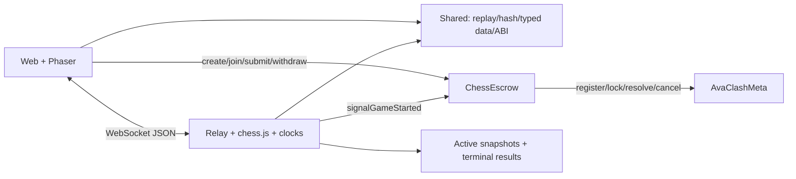

# Kiến trúc AvaClash Chess

Cập nhật 01/11/2026 theo mã nguồn và ADR. Mục tiêu là Fuji Testnet, hỗ trợ Anvil để phát triển. Nguyên tắc: luật cờ tiêu chuẩn tách khỏi lớp kinh tế Web3.

## Thành phần

| Gói               | Trách nhiệm                                                                                           |
| ----------------- | ----------------------------------------------------------------------------------------------------- |
| `packages/shared` | Wrapper chess.js, replay, hash UCI, Result EIP-712 v2, Join v2, Zod, RelayClient, ABI sinh từ Foundry |
| `contracts`       | Solidity 0.8.24, OpenZeppelin, ChessEscrow và AvaClashMeta; test unit/fuzz/invariant                  |
| `packages/relay`  | Node.js/TypeScript/ws, xác thực ví, kiểm luật và thứ tự nước, đồng hồ, snapshot/kết quả, đồng ký      |
| `web`             | Next.js 16, React 19, Tailwind, Wagmi/Viem và Phaser 3 tải động ở client                              |



Relay có khóa ký và tiền gas riêng, không giữ tiền cược hoặc khóa ví người chơi. Việc relay đồng ký là một giả định tin cậy. Hợp đồng chỉ xác thực chữ ký, không chạy engine cờ.

## Vòng đời phòng

`createRoom(bool creatorIsWhite)` tạo Open với 0.01–1 AVAX. `joinRoom` nạp cùng mức cược, chuyển Active, đặt `startedAt` và gọi Meta `registerMatch` theo fail-fast. Màu quân cố định on-chain, relay chỉ đọc.

Khi hai ghế relay sẵn sàng, relay bắt đầu đồng hồ và gửi `signalGameStarted`: đánh dấu `gameStarted`, đặt `gameStartedAt`, khóa cược khán giả qua try/catch. Tín hiệu này không đợi tới nước thứ nhất.

Trong ván, relay xác thực socket/seq và luật cờ; client chỉ vẽ nước sau echo. Đồng hồ được cập nhật ngay trước hành động, kể cả giữa các timer tick; thay socket không khôi phục thời gian đã trôi qua. Ngắt mạng client không dừng đồng hồ. Restart có ân hạn tối đa 120 giây và bỏ qua thời gian server tắt.

Local/VPS dùng file: khi kết thúc, relay lưu terminal checkpoint và kết quả bằng tệp tạm + rename, rồi mới xóa snapshot active và đọc RPC/ký. Nếu ghi kết quả thất bại, giữ checkpoint để restart không tạo lại ván; không ký khi chưa lưu thành công. Nếu toàn bộ đĩa lỗi, không thể bảo đảm phục hồi sau restart. Client nhận `game_finished` trước bước RPC.

Render Free dùng PostgreSQL trên Neon thay cho filesystem tạm. Hàng đợi từng phòng tuần tự hóa actions/timer; thông báo nước đi và callback ký kết quả chỉ chạy sau commit. Snapshot active được thay bằng terminal result trong một UPDATE, có kiểm tra lease owner, giờ database và revision; kết quả terminal không bị ghi đè. Lease chỉ gia hạn khi có phòng đang chờ/chơi. Storage/lease lỗi khiến relay dừng gameplay, đóng socket và trả health 503 cho tới restart. Xem [hướng dẫn Render](RENDER_DEPLOY.md) về khôi phục, sleep và giới hạn Free.

Client kiểm lại replay/hash/outcome trước khi ký Result. `submitResult` chấp nhận hai người ký khác nhau trong `{playerA, playerB, relaySigner}`; thắng nhận 95% tổng pot ở `pendingWithdrawals`, hòa hoàn đủ hai bên. `withdraw` dùng pull payment và nonReentrant.

Open có thể hủy bởi người tạo. Active chưa được signal bắt đầu có thể abort sau 3 phút, hoàn đủ. `refundOnTimeout` dùng `max(startedAt, gameStartedAt) + 60 phút`. Hai nhánh bị chặn khi có claim single-signed đang chờ. Trạng thái Challenged dùng luồng phân xử riêng. Pause chỉ chặn create/join, không chặn thoát tiền.

## Chữ ký

Result domain `AvaClashChess`, version `2`, chain ID và địa chỉ Escrow. Struct:

```text
Result(uint256 matchId,address winner,uint8 outcome,uint8 reason,uint16 moveCount,bytes32 movesHash,uint256 nonce,uint256 deadline)
```

UCI nối bằng một dấu cách rồi keccak256; ván 0 nước băm chuỗi rỗng. `moveCount` đếm half-move. Join domain `AvaClashRelay`, version `2`, nonce dùng một lần hạn 60 giây; bind chain, Escrow và origin. Chi tiết ở [PROTOCOL.md](PROTOCOL.md).

## Meta và quản trị

- Meta chỉ gắn địa chỉ Escrow **một lần**, phải là hợp đồng khác địa chỉ 0. Owner không thể đổi sang hợp đồng khác để tự quyết kết quả pool đang giữ tiền.
- Khóa relay và trọng tài khác nhau ngay khi deploy, khi đề xuất và khi thực thi đổi khóa. Timelock 2 ngày; kiểm tra lại lúc thực thi để chặn hai đề xuất đồng thời nhập vai trò làm một.
- Escrow có thể đổi địa chỉ Meta qua timelock 2 ngày. Không tự di chuyển dữ liệu hoặc tiền giữa các Meta; thay Meta khi còn pool chưa xử lý vẫn cần quy trình vận hành riêng.
- ELO 1200, delta giảm theo cặp/ngày, cộng điểm mùa nếu principal ít nhất 0.5 AVAX; chỉ cập nhật khi ván đủ 20 half-move. Đây là rating lưu theo ví, chưa phải token ERC-721/SBT.
- Vault giữ tiền gốc trực tiếp và cho rút; chưa tích hợp yield. Quỹ thưởng dùng phân phối Merkle (SEASON_REWARDS.md), tách khỏi principal.
- Spectator có ba cửa Trắng/Đen/Hòa, ghi gross. Cược khóa khi signal bắt đầu hoặc hết 120 giây sau join. Ván dưới 20 half-move, pool cửa thắng rỗng, abort hoặc refund dẫn tới hoàn đủ gross, không thu phí. Pool hợp lệ thu 5% khi resolve.
- Meta revert khi settle không chặn tiền kỳ thủ: try/catch, retry resolve, fallback cancel sau 3 ngày, và khán giả có đường hoàn độc lập khi chưa resolve quá 7 ngày.

Single-signed mặc định tắt theo Q15. Khi bật, claim/challenge đặt bond `max(20% stake, 0.01 AVAX)`, challenge window 10 phút, arbiter deadline 24 giờ; kết quả mặc định vẫn có rủi ro kinh tế được ghi tại Q8/Q11.

## Giao diện và phần chưa hoàn thành

PvP có ví injected, chọn màu/mức cược, tra cứu phòng, relay, bàn cờ, lịch sử SAN, đồng hồ, đầu hàng/hòa, nộp kết quả và rút tiền. Phiên React được tách theo phòng/ví; localStorage chỉ lưu bản sao transcript. Giao dịch luôn dùng chain mục tiêu; thành công được xác định từ receipt `status=success`.

Hot-seat và UI gửi/rút Vault, nhận thưởng mùa đã có; spectator transaction UI vẫn đóng và hợp đồng mặc định tắt nhận cược mới. `VictoryModal` là component có sẵn chưa tích hợp lại vào luồng relay; giao diện dùng vùng kết quả trên trang. Không coi các component/mẫu chưa nối là tính năng hoàn thành.

Các giới hạn quan trọng: tin relay với đồng hồ/sự kiện ngoài bàn cờ, hai kỳ thủ có thể thông đồng ký pool, single-signed không có fraud-proof, nhiều ví vẫn cày ELO, quản trị root thưởng còn tập trung và chưa audit độc lập. Không có xác nhận sẵn sàng mainnet.
