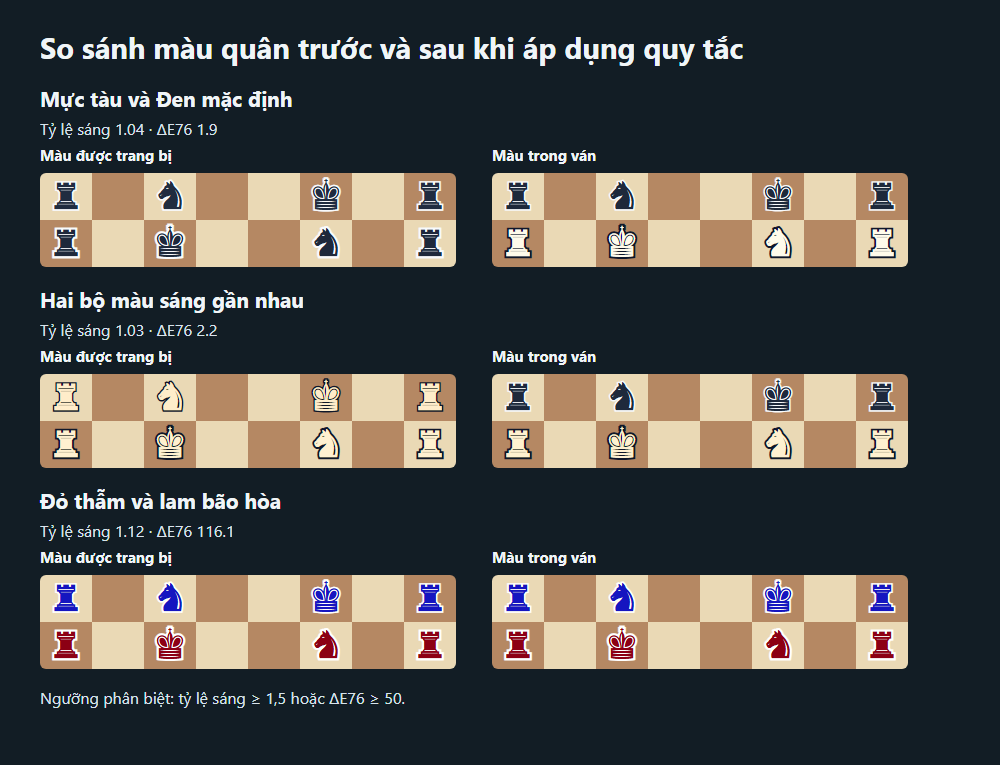

# Skin cúp AvaClash

Tài sản thử nghiệm trên Avalanche Fuji và Anvil Local, không có giá trị quy đổi. Hợp đồng cúp giới hạn triển khai ở chain ID 43113 và 31337. Tính năng chưa được audit.

## Nhận cúp và trang bị

- Chủ sở hữu `AvaClashCosmetics` đánh dấu tối đa một cúp cho mỗi giải tồn tại, trong giai đoạn đăng ký hoặc thi đấu và trước khi mở thời hạn duyệt cuối. Sau khi giải chốt, mọi kỳ thủ đồng hạng nhất theo `standings` được nhận một NFT, kể cả khi giải chia tròn tiền thưởng về 0. Tên UTF-8, màu, loại, số bản và ảnh SVG tối giản nằm trong dữ liệu on-chain. Chủ sở hữu hợp đồng cúp đánh dấu giải. Mỗi NFT gắn với ví vô địch đã nhận. Hợp đồng từ chối chuyển nhượng và phê duyệt cho ví khác.
- Ví được trang bị một bàn và một bộ quân. Bộ sưu tập phân trang các NFT và cúp theo lô 12 mục.

## Hiển thị trong ván

Bàn của Trắng được ưu tiên, tiếp theo là bàn của Đen rồi bàn mặc định. Mỗi kỳ thủ dùng màu quân tương ứng với bên mình cầm. Ký tự quân cờ giữ nguyên. Điều khiển **Tắt skin của đối thủ** chỉ thay đổi cách hiển thị trên thiết bị của kỳ thủ và lưu tùy chọn khi trình duyệt cho phép.

Ván trực tiếp và chế độ xem trực tiếp dùng chung dữ liệu trang bị tại khối phát sự kiện `Started` của giải. Kỳ thủ cần trang bị trước khi bắt đầu giải. Cách này giữ kết quả ổn định khi người chơi hoặc khán giả mở ván vào các thời điểm khác nhau. Client đọc một lần, dùng màu mặc định nếu chưa đọc được hoặc RPC thiếu trạng thái lịch sử. Bản phát lại đọc trang bị ở khối mới nhất tại thời điểm mở. Khán giả xem trực tiếp qua vai trò chỉ đọc sẵn có của relay. Hotseat, Tập cờ và phòng 1v1 cũ giữ giao diện hiện tại.

Ngưỡng hiển thị quân là 3:1 trên cả hai ô, ô nước cuối, nền hộp phong cấp và ô có lớp phủ chọn quân hoặc chiếu. Viền dày 0 không được tính. Hai bên phải có tỷ lệ độ sáng giữa màu tô từ 1,5:1 hoặc khoảng cách CIE76 từ 50. Nếu hai bên khó phân biệt, trả Đen về mặc định trước rồi trả cả hai nếu cần. Bàn tùy chỉnh phải có tương phản giữa hai ô từ 1,35:1 để tránh mất caro. Giữ nguyên các tham số vẽ cũ khi dùng mặc định.

Các mẫu tổng hợp dùng để so sánh gồm Mực tàu và Đen mặc định, hai bộ màu sáng gần nhau, và cặp đỏ thẫm với lam có độ sáng gần nhau. Hai mẫu đầu kích hoạt dự phòng. Mẫu đỏ–lam được giữ theo khoảng cách màu. Chưa kiểm với người dùng mù màu đỏ–lục. Công tắc tắt skin vẫn khả dụng cho kỳ thủ.



## Demo Anvil

Chạy ở thư mục gốc repo. Tạo phiên Anvil cục bộ mới cho demo.

```powershell
forge build --root contracts
anvil --host 127.0.0.1 --port 8545 --chain-id 31337 --quiet
```

Ở terminal khác, chạy script. Script chỉ kết nối loopback, kiểm tra Anvil và dùng tài khoản mở khóa qua RPC. Script dựng một giải chính thức hai người đồng hạng đã chốt.

```powershell
node scripts/dev-cosmetics.mjs 8545
```

Dùng các biến `NEXT_PUBLIC_*` script in ra để chạy web. Ví dụ có sẵn trong `web/.env.example`. Cần địa chỉ giải và địa chỉ hợp đồng cúp trên cùng mạng thử nghiệm. Mở `/collection` sau khi chạy `pnpm --filter web dev`. Một trong hai ví vô địch có thể nhận cúp, trang bị và bỏ trang bị.

Cũng có thể dùng tài khoản mở khóa Anvil. Điền địa chỉ hợp đồng và ví vô địch từ đầu ra của script.

```powershell
$rpc = "http://127.0.0.1:8545"
cast send --rpc-url $rpc --unlocked --from $winner $skins "claimTrophy(uint256)" 0
cast send --rpc-url $rpc --unlocked --from $winner $skins "equip(uint256)" 1
cast send --rpc-url $rpc --unlocked --from $winner $skins "unequip(uint8)" 0
```

Script `contracts/script/DeployCosmetics.s.sol` nhận `TOURNAMENT_ADDRESS` và `COSMETICS_OWNER_ADDRESS` và tạo hợp đồng cúp.

## Phạm vi giao dịch

Khoản 5 Điều 57 Nghị định 147/2024/NĐ-CP quy định về việc cấm mua bán vật phẩm ảo giữa người chơi. AvaClash đã gỡ chợ skin và dùng cúp gắn với ví nhận. Khi nâng cấp một môi trường đang dùng hợp đồng cúp cũ, cấu hình `NEXT_PUBLIC_COSMETICS_ADDRESS` trỏ vào hợp đồng cúp mới để áp dụng khóa chuyển nhượng. Việc cập nhật mã nguồn chỉ áp dụng cho bytecode biên dịch mới. [Nghị định 147/2024/NĐ-CP](https://datafiles.chinhphu.vn/cpp/files/vbpq/2024/11/147-nd.signed.pdf)
